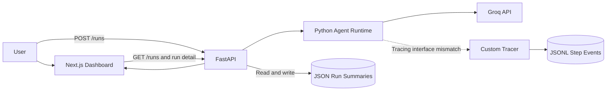

# Deep Synaptica

**AI Agent Observability & Evaluation Infrastructure**

Deep Synaptica is a research-oriented prototype for inspecting AI-agent runs and supporting run-level evaluation. It brings together a Python agent workflow, structured execution traces, a FastAPI service, and a Next.js dashboard to support analysis of observable execution behavior beyond the final response.

The repository is an **MVP / research infrastructure project**. Its components are implemented, but integration gaps currently prevent successful end-to-end run creation. It is not a production observability platform or a validated evaluation system.

## Research Motivation

How can AI-agent systems be evaluated and debugged when important behavior occurs across multiple model calls, tool interactions, and execution steps rather than only in the final answer?

Final-output evaluation alone can hide failed or unnecessary tool calls, latency bottlenecks, intermediate failures, inconsistent run behavior, and differences between successful and unsuccessful execution paths. Deep Synaptica explores the instrumentation needed for this kind of analysis through a small learning-plan workflow. The current runtime uses model calls only; tool execution and tool-call tracing are not implemented.

## What Deep Synaptica Observes

The custom tracer's `log_step()` method appends structured events to a per-run JSONL file. Its implemented event schema contains:

| Field | Observable information |
|---|---|
| `run_id`, `agent_version` | UUID run identifier and runtime version label |
| `step_type` | Workflow stage; the runtime defines `PLAN`, `EXPLAIN`, and `TODO` |
| `prompt`, `response` | Per-step prompt text and model output |
| `latency_ms` | Caller-supplied step duration in milliseconds |
| `created_at` | UTC event timestamp |
| `meta`, `error` | Optional event metadata and error text |

The runtime measures elapsed time around model calls, but its tracing calls do not match the tracer interface yet. The schema supports metadata and errors; the current runtime does not forward request metadata or log provider failures as events. System messages, model identifiers, token usage, and tool interactions are not recorded by this tracer.

## Architecture

The diagram distinguishes implemented component relationships from connections that still need integration work:



The API reads `*.json` run summaries, while the tracer writes `*.jsonl` step events. No JSONL-to-summary reader is implemented. The API contains summary persistence logic after agent execution returns, but the runtime currently fails before that return.

### Core Components

| Component | Role in the repository |
|---|---|
| Dashboard | Server-rendered run list and detail pages, including raw step JSON |
| API | Health check, run-summary retrieval, and a run-creation handler |
| Agent runtime | Sequential Groq calls for a seven-day plan, explanation, and checklist |
| Tracing layer | Custom Python event serialization with per-run JSONL append |
| Storage | Local JSONL events and separate API-managed JSON summaries |

## Current Capabilities

- Registered health, run-list, run-detail, and run-creation routes.
- File-based retrieval of existing JSON summaries, including a 404 for a missing run.
- A Groq chat-completion wrapper and a three-stage tutor workflow with per-call elapsed-time measurement.
- A tracer that generates run IDs and writes structured step events when `log_step()` is called directly.
- Dashboard pages that fetch runs and display run details and step payloads. There is no run-creation form or comparative evaluation view.

These are implementation-level capabilities. Successful run creation and complete dashboard rendering remain subject to the integration limitations below.

## API

| Method | Endpoint | Implemented behavior |
|---|---|---|
| `GET` | `/health` | Returns API service status; does not check the provider or tracing pipeline |
| `GET` | `/runs` | Reads JSON summaries; returns `total` and `runs` |
| `GET` | `/runs/{run_id}` | Returns a JSON summary, or 404 if absent |
| `POST` | `/runs` | Accepts a nonempty `prompt` and optional `meta`; invokes the runtime and maps execution errors to HTTP 500 |

Example request, once the API is running:

```bash
curl -X POST http://127.0.0.1:8000/runs \
  -H "Content-Type: application/json" \
  -d '{"prompt":"Learn Python fundamentals","meta":{}}'
```

This request currently encounters the runtime/tracer mismatch after a successful first model call, or a provider error before that. It is not a working end-to-end demonstration yet.

## Quick Start

These commands configure the existing services; they do not resolve the integration gaps. Run from the repository root using Python 3.11 (the CI target) and Node.js 20.9 or later (the Next.js package requirement).

### 1. Environment configuration

The root `.env.example` is empty. Combine the service examples into a local `.env`:

```bash
cp services/agent/.env.example .env
printf '\n' >> .env
cat services/api/.env.example >> .env
```

Set `GROQ_API_KEY` in `.env` to a local credential. Keep `TRACE_DIR=./data/logs`; launching from the root gives the API and tracer the same storage directory. The Groq wrapper defaults to `llama-3.3-70b-versatile` with temperature `0.3`. An optional `GROQ_MODEL` override must be present before application import; Uvicorn's `--env-file` below loads it at startup. `CORS_ORIGINS` appears in the example, but the current API uses a hardcoded wildcard CORS policy.

### 2. Python dependencies

```bash
python3 -m venv .venv
source .venv/bin/activate
python -m pip install -r requirements.txt
```

On Windows PowerShell, activate with `.venv\Scripts\Activate.ps1` and set environment variables using PowerShell syntax.

### 3. API launch

From the root, with the virtual environment active:

```bash
PYTHONPATH="$PWD/services:$PWD/services/api" \
  python -m uvicorn app.main:app --env-file .env \
  --host 127.0.0.1 --port 8000 --reload
```

Both import paths are needed for the current `app.main` and `agent.agent.run` imports; the route module's own path insertion points to a nonexistent root-level `agent/` directory.

### 4. Dashboard launch

In a separate terminal, from the repository root:

```bash
cd apps/dashboard
npm ci
NEXT_PUBLIC_API_BASE=http://127.0.0.1:8000 npm run dev
```

Open <http://localhost:3000/runs>. The dashboard reads the API base from `NEXT_PUBLIC_API_BASE` and requires it at startup.

### 5. Health check and basic request

Open <http://127.0.0.1:8000/health> to check API availability. The POST example above exercises the run handler, with the current failure behavior documented in the API section. Without existing JSON summaries, the run list is empty; JSONL files alone do not populate it.

## Evaluation Status

The current repository provides observability/evaluation infrastructure components; it does **not** establish a validated benchmark for agent quality. No comparative performance claim should be inferred. Current evidence is implementation-level and concerns the fields and interfaces available for run-level observability, with incomplete end-to-end integration.

The research goal is instrumentation and reproducible run inspection. A controlled evaluation suite comparing agent configurations, prompts, or failure modes is future research work rather than a completed result. No experimental metrics or comparative findings are reported here.

## Research Directions

- Run-level evaluation that combines final outputs with observable execution events.
- Failure-mode analysis across model calls and workflow stages.
- Controlled prompt and configuration comparisons across repeated runs.
- Trace-based evaluation datasets with sufficient configuration metadata for reproducibility.

## Limitations

- Deep Synaptica is currently an MVP / research prototype rather than a production observability platform. JSONL/file-based persistence is intended for experimentation, not high-scale deployment.
- End-to-end integration across agent execution, trace persistence, API summaries, and dashboard views is still evolving, and tracing coverage does not yet capture every runtime or failure event automatically.
- The current system does not yet provide a validated benchmark for agent quality or comparative performance results.
- Provider/runtime coverage is currently limited to Groq and a fixed learning-plan workflow; general tool-executing agents are not yet supported.
- Recorded traces represent observable execution events; they do not expose hidden chain-of-thought, establish causal explanations, or provide model interpretability.
- Reproducibility metadata is still incomplete; fuller model configuration and request metadata will be required for controlled cross-run experiments.

## Technical Stack

| Layer | Technology verified in the repository |
|---|---|
| Frontend | Next.js 16.1.4, React 19.2.3, TypeScript |
| Backend | Python, FastAPI, Uvicorn, Pydantic |
| Agent runtime | Python, Groq SDK and chat-completions API |
| Tracing | Custom Python tracer; structured JSONL events |
| Storage | Local files: JSONL events and JSON summaries |
| CI configuration | GitHub Actions workflow for API import/lint and frontend build |

The checked-in CI workflow is not evidence of passing checks: it contains a Markdown code fence and references `services/api/requirements.txt`, which does not exist. Dependencies are at the repository root; backend lint failures are also suppressed. Pytest is declared as a dependency, but no Python test suite is checked in.

## Repository Structure

```text
deep-synaptica/
├── services/
│   ├── api/app/               # FastAPI entry point and health/run routes
│   └── agent/agent/           # Groq workflow and tracing/tracer.py
├── apps/dashboard/
│   ├── app/                   # Next.js pages
│   ├── lib/                   # API client and TypeScript types
│   ├── apps/dashboard/        # Nested duplicate dashboard tree
│   └── services/              # Duplicate backend source tree
├── .github/workflows/ci.yml
├── docs/                      # Empty architecture/PRD placeholders
├── scripts/                   # Empty database/demo script placeholders
├── requirements*.txt          # Python dependency files
└── README.md
```

The quick start uses the root `services/` tree and `apps/dashboard/` frontend, not the nested copies. The root `Makefile` and `docker-compose.yml` are empty placeholders.

## Author

**Marwan M. Al-Falah**<br>
MSc Researcher in Intelligent Systems<br>
Peter the Great St. Petersburg Polytechnic University

[Academic portfolio](https://marwanmalfalah.github.io/malfalah/)

The project originated during an AI-agent hackathon and is now presented as an observability/evaluation research prototype.
